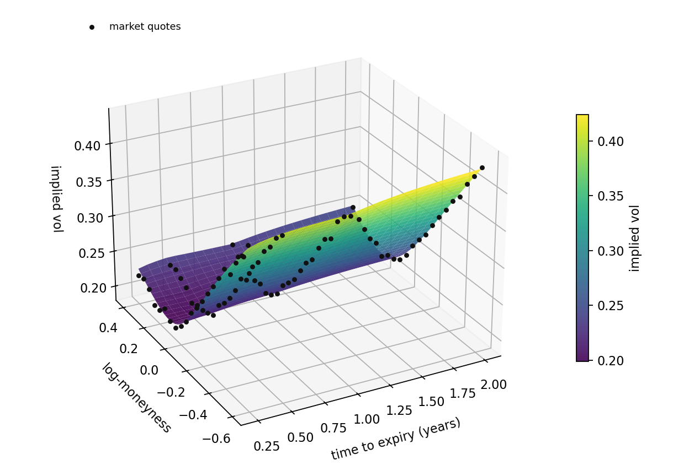
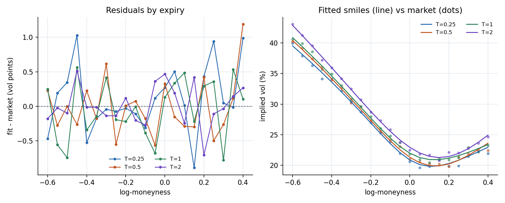
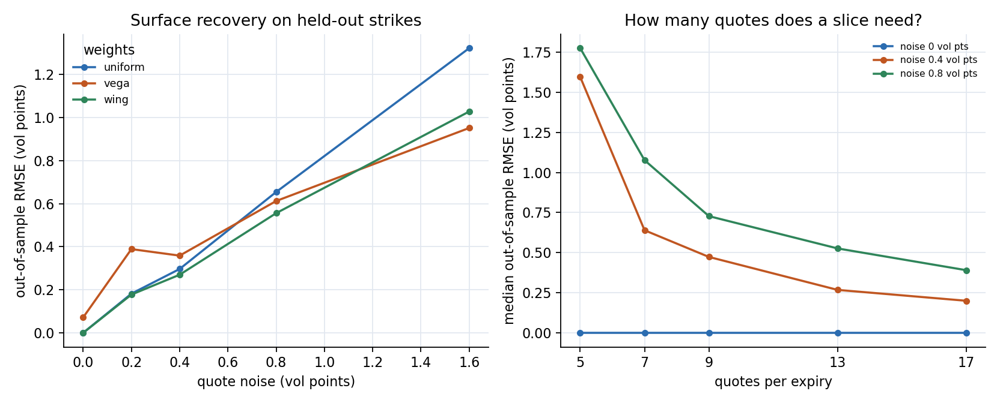

# cppquant-options

European and American option pricing in modern C++20, with analytic
Black-Scholes-Merton Greeks, a robust implied-volatility solver, a
Cox-Ross-Rubinstein binomial tree and a Monte Carlo engine with variance
reduction. No third-party dependencies.

[](https://github.com/Bruce848647703/cppquant-options/actions/workflows/ci.yml)

## What the calibration actually does

`demo/` generates a synthetic arbitrage-free SVI chain, calibrates every expiry,
and scores the result on strikes that were held out of the fit. The whole
experiment is reproducible:

```bash
make -C demo demo            # build, run, plot
make -C demo demo PYTHON=python   # if python3 lacks matplotlib
```







Setup: four expiries (0.25–2.0 years), 21 strikes per expiry over
log-moneyness `[-0.6, 0.4]`, zero-mean Gaussian noise added to implied
volatility. Raw numbers are in `demo/outputs/*.csv`.

### Weighting is a bias-variance trade-off

Out-of-sample RMSE on held-out strikes, in volatility points:

| quote noise | uniform | vega | wing |
| --- | --- | --- | --- |
| 0.0 | 0.00 | 0.07 | 0.00 |
| 0.2 | 0.18 | 0.39 | 0.18 |
| 0.4 | 0.30 | 0.36 | 0.27 |
| 0.8 | 0.65 | 0.61 | 0.56 |
| 1.6 | 1.32 | 0.95 | 1.03 |

Vega weighting suppresses the wings, so it is biased exactly where vega is
small; uniform weighting is unbiased but amplifies noise. The crossover is
around 0.7 volatility points of quote noise, and no choice dominates.

### Sparse slices overfit

Median out-of-sample error against the clean surface at 0.4 volatility points
of noise:

| quotes per expiry | in-sample | out-of-sample | draws off by >5 vol pts |
| --- | --- | --- | --- |
| 5 | 0.37 | 1.60 | 15.0% |
| 7 | 0.32 | 0.64 | 17.5% |
| 9 | 0.29 | 0.47 | 2.5% |
| 13 | 0.24 | 0.27 | 0.0% |
| 17 | 0.22 | 0.20 | 0.0% |

In-sample error is flat at 0.2–0.4 volatility points regardless of how few
strikes are used. Out-of-sample error falls about eight-fold from 5 to 17
quotes, and with 5–7 quotes roughly one draw in six is off by more than 5
volatility points. Five quotes is the parameter count: it identifies a slice,
it does not constrain it.

### Limitations

- The synthetic chain is generated *by* raw SVI, so the zero-noise case is
  exact by construction. These numbers measure estimator behaviour, not model
  misspecification on real quotes.
- The term structure is imposed, not estimated.
- The convergence flag is strict; some fits hit the iteration cap with
  negligible accuracy loss (see `all_converged` in the CSVs).
- Arbitrage checks are evaluated on a grid over `[-1, 1]` log-moneyness, not
  globally.

## Features

- **Black-Scholes-Merton** prices and analytic Greeks for European calls and
  puts, with continuous dividend yield and support for negative rates.
- **Implied volatility** via a Newton iteration guarded by a bisection
  bracket, with explicit no-arbitrage bounds.
- **SVI calibration** for one expiry: constrained raw SVI slices fitted by
  weighted least squares with a Levenberg-Marquardt optimizer.
- **Volatility surface**: multi-expiry SVI interpolation in total variance and
  log-forward, with calendar and butterfly arbitrage checks.
- **Dupire local volatility**: local variance and volatility from the surface,
  with diagnostics for negative density and a local-vol Crank-Nicolson PDE.
- **Barrier options**: analytic European down-and-out calls and puts, delta and
  vega, and a barrier-aligned Crank-Nicolson PDE cross-check.
- **American Monte Carlo**: Longstaff-Schwartz regression on in-the-money
  paths, antithetic variates, a European-payoff control variate and comparison
  with the binomial tree.
- **Crank-Nicolson PDE**: uniform spot grid, Rannacher smoothing, American
  exercise projection and finite-difference delta/gamma.
- **Binomial CRR tree** for European and American options, including early
  exercise with dividends.
- **Monte Carlo** for European options with antithetic variates, a
  terminal-stock control variate, standard errors and deterministic seeds.
- **Edge cases**: expired options, zero volatility, deep in/out-of-the-money
  strikes, invalid inputs.
- Tests with reference values, put-call parity, finite-difference Greeks and
  Monte Carlo convergence; CI with GCC, Clang, Apple clang and ASan/UBSan.

## Quick start

Requirements: a C++20 compiler and CMake 3.20+. Ninja is optional.

```bash
cmake -S . -B build -G Ninja -DCMAKE_BUILD_TYPE=Release
cmake --build build
ctest --test-dir build --output-on-failure
```

The plotting demo additionally needs `matplotlib` and `pandas`:

```bash
pip install -r demo/requirements.txt
make -C demo demo
```

Sanitizer build:

```bash
cmake -S . -B build-asan -G Ninja \
  -DCMAKE_BUILD_TYPE=Debug -DCPPQUANT_SANITIZE=ON
cmake --build build-asan
ctest --test-dir build-asan --output-on-failure
```

Install and consume:

```bash
cmake --install build --prefix /tmp/cppquant
```

```cmake
find_package(cppquant_options CONFIG REQUIRED)
target_link_libraries(my_target PRIVATE cppquant::options)
```

## Library usage

```cpp
#include "cppquant/options.hpp"

using namespace cppquant;

OptionSpec call;
call.type = OptionType::Call;
call.spot = 100.0;
call.strike = 100.0;
call.time_to_expiry = 1.0;
call.volatility = 0.20;
call.risk_free_rate = 0.05;
call.dividend_yield = 0.0;

const double price = black_scholes_price(call);   // 10.450583572...
const Greeks greeks = black_scholes_greeks(call); // delta, gamma, vega...
const double iv = implied_volatility(call, price);

OptionSpec american = call;
american.type = OptionType::Put;
american.style = ExerciseStyle::American;
const double american_put = binomial_price(american, 1000);

const auto mc = monte_carlo_price(call, 200'000, /*seed=*/42);
// mc.price, mc.standard_error, mc.effective_samples
```

### Units

- `time_to_expiry` is in years, `volatility` and rates are annualized decimals
  (`0.20` = 20%).
- `vega` is per 1.00 change in volatility; divide by 100 for "per 1%".
- `rho` is per 1.00 change in the risk-free rate; divide by 100 for "per 1%".
- `theta` is per year of calendar time.
- Prices and Greeks use the same units as `spot` and `strike`.

### SVI slice

```cpp
#include "cppquant/volatility.hpp"

std::vector<VolQuote> quotes = {
    {90.0, 0.28, 1.0}, {95.0, 0.24, 1.0}, {100.0, 0.22, 1.0},
    {105.0, 0.23, 1.0}, {110.0, 0.26, 1.0},
};

const SviFitResult fit = calibrate_svi(100.0, 0.5, quotes);
const double atm_vol = fit.slice.implied_volatility_for_strike(100.0);
// fit.rmse, fit.max_error, fit.iterations, fit.converged
```

The optimizer keeps `b > 0`, `|rho| < 1`, `sigma > 0` and the minimum total
variance non-negative by construction. See
[docs/SVI.md](docs/SVI.md) for the parameterization and optimizer details.

### Volatility surface

```cpp
#include "cppquant/surface.hpp"

std::vector<SurfaceSlice> slices;
for (double expiry : {0.25, 0.5, 1.0, 2.0}) {
  const double forward = 100.0 * std::exp(0.03 * expiry);
  const double df = std::exp(-0.03 * expiry);
  slices.push_back(SurfaceSlice{
      SviSlice{forward, expiry, params_for(expiry)}, df});
}
VolatilitySurface surface(std::move(slices));

const double vol = surface.implied_volatility(100.0, 0.75);
const double call = surface.price(105.0, 0.75, OptionType::Call);
const bool clean = surface.is_arbitrage_free();

const double local_var = surface.local_variance(105.0, 0.75);
const double local_vol = surface.local_volatility(105.0, 0.75);
```

Total variance, log-forward and log-discount are interpolated in time. Queries
outside the slice range throw instead of extrapolating. See
[docs/SURFACE.md](docs/SURFACE.md) for the interpolation, pricing and
calendar/butterfly checks.

### American Monte Carlo

```cpp
#include "cppquant/american_mc.hpp"

OptionSpec american{OptionType::Put, ExerciseStyle::American,
                    100.0, 100.0, 1.0, 0.2, 0.05, 0.0};

LongstaffSchwartzSettings settings;
settings.paths = 200'000;
settings.exercise_steps = 50;
settings.seed = 42;
settings.control_variate = true;

const auto result = longstaff_schwartz_price(american, settings);
// result.price, result.standard_error, result.early_exercise_premium
```

See [docs/LSM.md](docs/LSM.md) for the regression setup, exercise policy and
accuracy notes.

### Crank-Nicolson PDE

```cpp
#include "cppquant/pde.hpp"

PdeSettings settings;
settings.space_steps = 400;
settings.time_steps = 400;

const PdeResult result = crank_nicolson_price(american, settings);
// result.price, result.delta, result.gamma

const PdeResult local =
    crank_nicolson_local_vol_price(american, surface, settings);
// local.clamped_local_variance_points counts floored variance evaluations
```

See [docs/PDE.md](docs/PDE.md) for the discretization, boundaries, local-vol
path and convergence table.

### Barrier options

```cpp
#include "cppquant/barrier.hpp"

OptionSpec barrier_call{OptionType::Call, ExerciseStyle::European,
                        100.0, 100.0, 1.0, 0.2, 0.05, 0.02};

const BarrierGreeks greeks = down_and_out_greeks(barrier_call, 80.0);
const PdeResult pde = crank_nicolson_down_and_out_price(
    barrier_call, 80.0, settings);
```

The analytic formulas use a continuous barrier and no rebate. The PDE places
the barrier exactly on the lower grid boundary. See
[docs/BARRIER.md](docs/BARRIER.md) for the formulas, Greeks and cross-check.

## Command-line pricer

```bash
./build/option_pricer \
  --type call --spot 100 --strike 100 --time 1 \
  --vol 0.2 --rate 0.05 --market 10.450583572186
```

```text
cppquant-options
call european  spot=100.0000  strike=100.0000  T=1.0000  vol=0.2000  r=0.0500  q=0.0000

black-scholes (european)
  price       10.450584
  delta        0.636831
  gamma        0.018762
  vega        37.524035
  theta       -6.414028
  rho         53.232482

binomial (european, 500 steps)
  price       10.446585

implied volatility (market 10.450584)
  vol          0.200000

monte carlo (200000 paths, antithetic + control variate)
  price       10.451654  (se 0.006111, 200000 samples)
```

Use `--style american` for the binomial American price. `--no-mc` skips Monte
Carlo and `--help` lists every flag.

## Benchmark

```bash
./build/options_bench          # full run
./build/options_bench --quick  # CI smoke test
```

Reference numbers from an Apple M-series laptop (Apple clang 21, `-O3`):

| Workload | Volume | Latency | Throughput |
| --- | ---: | ---: | ---: |
| Black-Scholes price + Greeks | 1,024,000 options | 80 ns/option | 12.5 M options/s |
| Implied volatility | 20,000 options | 379 ns/option | 2.6 M options/s |
| SVI calibration, 25 quotes | 2,000 fits | 17.4 µs/fit | 57.6 k fits/s |
| Surface price + IV, 4 slices | 1,000,000 ops | 81.3 ns/op | 12.3 M ops/s |
| LSM American put | 200,000 paths × 50 steps | 331 ms | 0.60 M paths/s |
| PDE Crank-Nicolson | 400 × 400 grid | 0.85 ms/price | 1.2 k prices/s |
| PDE Dupire local vol | 400 × 400 grid | 7.0 ms/price | 143 prices/s |
| Barrier analytic price | 200,000 prices | 51 ns/price | 19.6 M prices/s |
| Barrier price + delta + vega | 200,000 prices | 264 ns/price | 3.8 M prices/s |
| PDE barrier down-and-out | 400 × 400 grid | 0.94 ms/price | 1.1 k prices/s |
| Binomial American, 500 steps | 200 prices | 106 µs/price | 9.5 k prices/s |
| Monte Carlo, 200,000 paths | 20 runs | 3.0 ms/run | 66 M paths/s |

These are indicative; run the benchmark on your own hardware.

## Accuracy notes

- Black-Scholes prices agree with reference values to better than `1e-9`.
- The implied-volatility solver converges to `1e-7` in volatility across a
  grid of strikes, maturities and volatilities, including negative rates.
- The CRR tree converges to Black-Scholes as steps increase; for 1,000 steps
  the European error is below `5e-3` on the tested cases.
- SVI calibration recovers synthetic parameters to about `1e-3` and reproduces
  a 25-quote smile with implied-vol errors below `1e-9`.
- A flat volatility surface reproduces Black-Scholes to better than `1e-10`;
  calendar/butterfly checks detect constructed arbitrage.
- LSM American prices agree with a 1,000-step binomial tree within 1% or four
  standard errors on the tested put and dividend-paying call.
- Adding the European control variate cuts the LSM standard error by about 48%
  versus plain no-variance-reduction Monte Carlo at 200,000 paths.
- The Crank-Nicolson solver reaches `1e-4` European accuracy on a 3,000-node
  grid and matches the binomial tree within 1% for American options.
- The local-vol PDE reproduces Black-Scholes within `2e-3` on an 800 × 800
  grid for a flat surface, matches the total variance of a two-slice term
  structure and reproduces a skewed SVI surface price within `2e-3`.
- Monte Carlo uses the sample standard error of the estimator after variance
  reduction. Antithetic pairs are averaged before estimating the control
  variate, so both techniques reduce the variance of the reported estimator.
- Deep in-the-money prices sit at the no-arbitrage bound to machine precision.
  Implied volatility is not numerically identifiable there and the solver
  returns zero; the tests skip those degenerate round trips.

## Design

```text
include/cppquant/options.hpp   public API and data types
src/black_scholes.cpp          validation, normal CDF/PDF, analytic prices
src/implied_volatility.cpp     bracketed Newton solver
src/binomial.cpp               CRR tree, deterministic zero-vol scan
src/monte_carlo.cpp            GBM sampling, antithetic + control variate
src/svi.cpp                    raw SVI calibration
src/surface.cpp                surface interpolation, pricing and checks
src/barrier.cpp                down-and-out analytics and Greeks
src/american_mc.cpp            Longstaff-Schwartz American Monte Carlo
src/pde.cpp                    Crank-Nicolson and local-vol finite differences
examples/option_pricer.cpp     CLI
demo/surface_demo.cpp          calibration/no-arbitrage data generator
```

See [docs/MATH.md](docs/MATH.md) for the formulas, the Greeks, the CRR
recursion and the variance-reduction details.

### Modelling limits

- Black-Scholes assumes constant volatility and log-normal returns.
- Monte Carlo supports European exercise only; American options use the
  binomial tree.
- The CRR tree rejects parameters where the risk-neutral probability falls
  outside `[0, 1]`, rather than silently returning a misleading price.
- Local volatility comes from a fitted surface; there is no stochastic
  volatility, jump diffusion or discrete dividend schedule.
- Barrier options use continuous monitoring, no rebate and European exercise
  only; up-and-out and double barriers are not implemented.
- The local-vol PDE keeps the drift from the option's constant rate and
  dividend yield, so the surface forwards should be consistent with them.

## Tests

The repository ships a tiny header-only test harness, so the build has no
external test dependency. The 90 tests cover:

- three sets of reference prices and Greeks (ATM, dividends, negative rates);
- put-call parity and finite-difference checks of every Greek;
- expiry, zero volatility and invalid-input behaviour;
- implied-volatility round trips across 50+ combinations and no-arbitrage
  rejection;
- binomial convergence, American early exercise and zero-vol exercise scans;
- Monte Carlo accuracy, reproducibility, variance reduction and argument
  validation;
- SVI formula checks, symmetric and asymmetric parameter recovery, quote
  round-trips, narrow strike ranges and constraint enforcement;
- flat-surface Black-Scholes reproduction, midpoint interpolation, forward
  parity, calendar/butterfly detection and surface validation;
- LSM American put/call accuracy, reproducibility, antithetic rounding, zero
  volatility, expiry, immediate exercise and invalid settings;
- control-variate standard-error reduction, path-count convergence and basis
  degree comparisons;
- Crank-Nicolson European/american accuracy, convergence, Greeks, expiry,
  zero-volatility fallback and deep in-the-money boundaries;
- Dupire local variance against finite-difference Dupire prices, flat and
  term-structure surfaces, negative-variance flooring and local-vol PDE
  accuracy on skewed surfaces, American exercise and validation;
- down-and-out analytic prices against independent reflection integrals,
  knockout limits, delta/vega, PDE agreement, zero volatility and validation.

```bash
./build/options_tests             # all tests
./build/options_tests implied     # filter by substring
```

## Roadmap

The 8-week plan (2026-11-09 to 2027-01-03), milestones and acceptance criteria
live in [docs/ROADMAP.md](docs/ROADMAP.md). Current and historical numbers are
in [docs/BENCHMARKS.md](docs/BENCHMARKS.md); user-visible changes are tracked in
[CHANGELOG.md](CHANGELOG.md).

## License

MIT. See [LICENSE](LICENSE).
